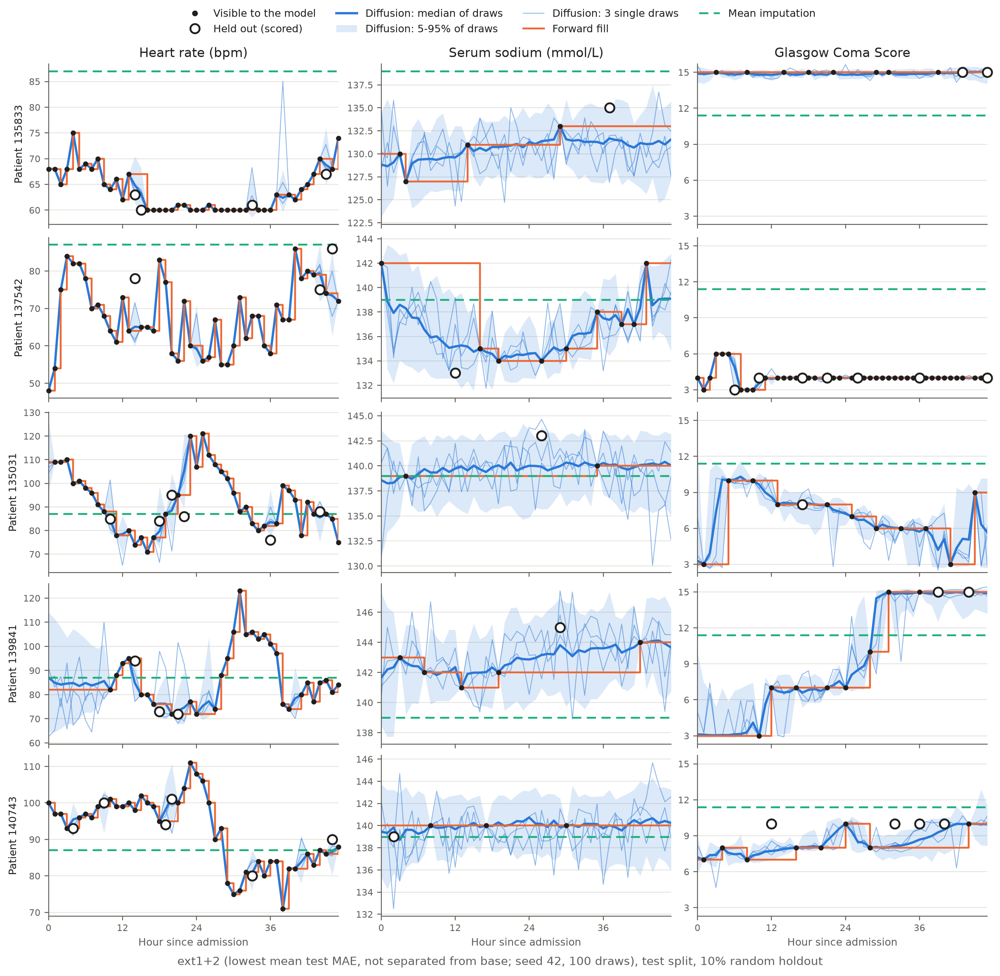

# Reconstructed trajectories: a qualitative read (M7-3)

**What is shown.** Five test patients (rows) by three variables (columns), in clinical units, over
the 48 hours, on the frozen 10% random holdout. The model is the sweep's Ext 1+2, the variant with
the lowest mean test MAE at 10% (0.2186 over seeds 42-46). That is not separated from base (paired
Δ −0.0011 ± 0.0013, 95% CI −0.0047 to +0.0024; PROJECT_PLAN §3.5), so nothing below claims that
Ext 1+2 beats base. Base's per-variable errors overlap the ones in the table (HR 4.14-4.19, sodium
2.14-2.28, GCS 0.65-0.70). The 100 draws are from seed 42's weights. The patients were picked by a
fixed rule, not by eye: among the 137 test patients with at least one held-out value and at least
two visible values in all three variables, five evenly spaced in the test split's order. Filled
dots are what the model saw; open rings are the held-out values it is scored on. Data and per-panel
numbers: `trajectories.npz`, `trajectories.json`, `draw_check.json` (`diffusion.trajectories`;
figure by `diffusion.trajectories_plot`).

**The numbers behind it** (test split, all 800 patients, mean absolute error in clinical units on
the held-out values; diffusion is each seed's protocol median of 100 draws):

| Variable | Held-out values | Diffusion, seeds 42-46 | Linear interpolation | Forward fill | Mean imputation |
| --- | --- | --- | --- | --- | --- |
| HR (bpm) | 3,490 | 4.14-4.17 | 4.41 | 5.29 | 13.57 |
| Serum sodium (mmol/L) | 269 | 2.14-2.42 | 1.94 | 2.25 | 3.22 |
| GCS | 1,247 | 0.66-0.69 | 0.62 | 0.75 | 3.51 |

Linear interpolation, a straight line between the visible values, is not one of the protocol's
baselines and is not in the figure. It is here because it is the simplest guess that reads both
sides of a gap, so it shows how much of the model's margin over forward fill that alone would give.

## Where diffusion tracks the dynamics

- **Densely charted vitals (HR).** With a value nearly every hour, the median runs through the visible
  points and, across a short gap, joins its two neighbours. Forward fill gives a held-out hour the
  last reading before it. HR is the one variable of the three where the model beats interpolation
  as well as forward fill, on every seed: 4.14-4.17 bpm against 4.41 and 5.29. About three quarters
  of its margin over forward fill is what interpolation alone gets.
- **Both sides of a gap, not only the past.** Forward fill reads earlier values, apart from the hours
  before a variable's first visible value, which take that first value. The model reads the whole
  stay. Patient 137542's sodium is 142 at admission and next visible at 135 at hour 16. Forward fill
  holds 142 through hour 15 and is 9 mmol/L off at the held-out value at hour 12 (133). The model's
  median comes down through the gap towards the next visible value and is 2.2 off.
- **Plateaus and transitions in GCS.** GCS sits on plateaus (15 for the alert patients, 3-4 for
  patient 137542) and the median sits on them, as forward fill does. Where it changes, the median
  moves between the visible values instead of waiting for the next one. Patient 139841 rises from 3
  at hour 10 to 15 at hour 31, through 7 over hours 12-24 and 10 at hour 28. Over hours 29-30 the
  median is already at 14.5-14.8, where forward fill still holds 10.
- **Uncertainty where there is little to go on.** The band widens before the first visible value and
  in long gaps (patient 139841's HR over hours 0-8, every sodium panel), and narrows to almost
  nothing beside dense visible values.

## Where it does not

- **Sodium and GCS: a straight line does better.** Interpolation beats the model on both, on every
  seed: 1.94 against 2.14-2.42 mmol/L for sodium, and 0.62 against 0.66-0.69 for GCS. It also improves
  on forward fill by 13% and 18%, so there is temporal structure between these measurements that
  the model is not fully using. On sodium the model is only level with forward fill, and seed 46 is
  worse than it (2.42 against 2.25).
- **Isolated departures are not predicted.** A held-out value that breaks from both neighbours is
  missed by the model as by forward fill. Patient 137542's HR of 78 at hour 14, between visible values
  of 64 and 65, is imputed as 65. Patient 135031's HR of 86 at hour 22, a one-hour dip between visible
  values of 95 and 120, is imputed as 105, further off than forward fill's 95. Patient 140743's GCS of
  10 at hour 12, between visible values of 7 and 8, is imputed as 7.7.
- **A step inside a long gap gets smoothed.** Patient 140743's GCS is 8 at hour 28 and next visible
  at 10 at hour 44, but the held-out values show it was already 10 by hour 32. The median climbs
  gradually (8.1 at hour 32, 8.7 at hour 36, 9.5 at hour 40). That is closer than forward fill's 8,
  but late. The two values at hours 32 and 36, the two isolated HR values and the GCS value at hour 12
  are 5 of the 8 held-out values in the figure that fall outside the band.
- **The 90% band runs a little narrow.** Over all 137 eligible patients, the 5-95% band of the draws
  covers 86.5% of the held-out values (899 of 1,039): HR 85.8%, sodium 83.7%, GCS 89.4%. In the
  figure it covers 35 of 43. A patient's held-out values are not independent, so we do not put a
  precise margin on the shortfall. Closing a gap like this is what a conformal calibration step is
  for (M9-3).
- **Single draws are rougher than the median, but not rougher than the data, except for GCS.** The
  median averages over draws, so it moves far less from hour to hour than either the draws or the
  patient (HR: 1.9 bpm, against 6.2 for a draw and 5.4 for real charted values). Over the 137 patients,
  HR draws move about as much as real HR at every gap from 1 to 12 hours (6.2 against 5.4 at 1 hour,
  11.4 against 11.2 at 12). Sodium draws do too (2.3 against 2.8 at 1 hour, 2.6 against 3.1 at 12),
  though few real sodium pairs are charted an hour or two apart (11 and 30). GCS draws move 23-55% more
  than real GCS, and take values between the integers. These compare hours hidden from the model
  with hours that were charted, which are not the same hours. A draw's departure from the median is
  only weakly linked from one hour to the next (correlation 0.38 for HR, 0.16 for sodium, 0.24 for
  GCS).

## For Week 9 (M9-2)

Across all 35 variables, the model's relative gain over forward fill tends to rise with how densely
a variable is charted (rank correlation 0.68, a first look from each seed's protocol median). Density
is not the whole story. HR, the densest variable (91% of patient-hours), gains 22%, while the six
arterial and non-invasive blood pressures, charted on 40-56% of patient-hours, gain 69-84%. Those
pressures are related to one another and charted together, so the model may be reading one from
another. M9-2 should test that, and compare against interpolation as well as forward fill. For the
fan plots, single draws are a fair picture of how HR and sodium move; GCS draws are more jittery
than real GCS.
